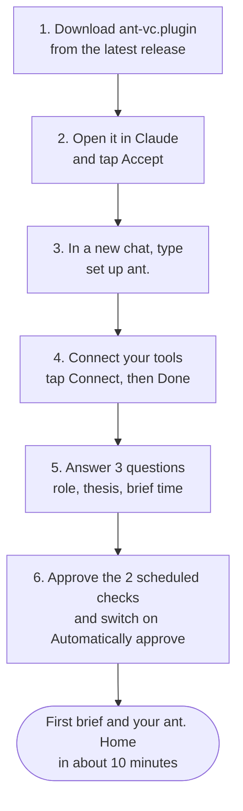
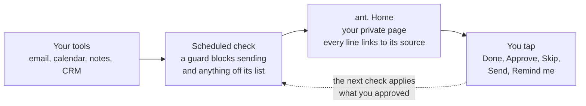
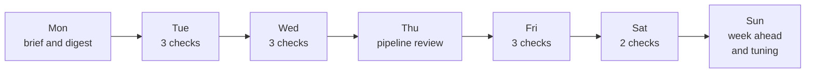

# Install ant. for VCs

ant. is a chief of staff for your fund that lives in the Claude app. It reads your email, calendar, notes and CRM. Each morning it gives you one private page: what to decide, what to send, who owes you what, and prep before every meeting.

- **About 10 minutes** to your first brief
- **2 tools required:** email and calendar
- **3 questions** during setup
- **0 emails** sent without your tap

A page version of this guide, with the same diagrams, is in [`docs/install-guide.html`](docs/install-guide.html). Download it and open it in any browser.

## What you need

| | What | Notes |
| --- | --- | --- |
| Required | The Claude app | Signed in, with plugins and scheduled tasks available on your plan. The desktop app is best: research on the people you meet runs only there. |
| Required | Email and calendar | Gmail and Google Calendar. Each asks you to sign in once. |
| Recommended | Meeting notes | Granola, Zoom, Fathom, Fireflies or Otter |
| Recommended | CRM | Affinity, Attio, HubSpot, Salesforce, Airtable, Notion, or a Google Sheet |
| Recommended | Google Drive | Where empathy maps are saved |

## Six steps, in order



1. **Download the plugin (1 min).** Open the [latest release](https://github.com/nikhilgundawar-ant/ant-vc/releases/latest) and download `ant-vc.plugin`.
2. **Accept it in Claude (1 min).** Open the file in the Claude app, or drop it into a chat. A plugin card appears. Tap **Accept**.
3. **Start setup (10 sec).** In a new chat, type `set up ant.`
4. **Connect your tools (3 min).** ant. shows a Connect card for each tool it can use. Tap Connect on the ones you use and skip the rest. Then tap **Done**. If a tool is connected but switched off in this chat, turn it on from the chat's connector menu.
5. **Answer three questions (1 min).**
   - Your role: partner, principal, associate, analyst, platform, finance and IR, or solo GP.
   - Your thesis in two lines. ant. drafts it from your email.
   - When you want your brief. 07:00 is the default.
6. **Approve the two scheduled checks (1 min).** ant. creates two scheduled tasks:
   - **ant.** runs three times on weekdays: before your brief, around midday and in the afternoon.
   - **ant. weekend** runs twice a day on weekends.
   - That is Light mode, 19 checks a week. Ask Claude `check every hour` if you want hourly checks on weekdays.

> **Do this or the checks will wait for you:** open Scheduled tasks, pick "ant." and "ant. weekend", and switch on **Automatically approve**. A guard still blocks everything except reading your tools, updating Home, CRM changes you approved, holds on your own calendar and saving drafts.

## What you'll be asked to allow

Claude shows a prompt for each of these. Tap **Allow** or **Accept**.

**Needed for ant. to work**

| Prompt | When | If you skip it |
| --- | --- | --- |
| Accept the plugin | Step 2 | Nothing installs |
| Sign in to Gmail and Google Calendar | Step 4 | Setup stops: ant. needs both |
| Approve the two scheduled checks | Step 6 | No briefs and no checks |
| Automatically approve, in Scheduled tasks | Step 6 | Every check waits for your tap |

**Asked once, the first time you use a feature in ant. Home**

| Prompt | What it turns on | If you say no |
| --- | --- | --- |
| Use Claude | TL;DRs in side panels, Ask, and drafts written for you | Those features hide; the rest works |
| Send with Gmail | Sending an edited draft from Home, after Send, then Send now | Use Open in Gmail instead |
| Use the app's browser | LinkedIn and web research on people you meet, desktop app only | No empathy maps |
| Save to Google Drive | Empathy maps saved as PDFs in Drive | Maps stay in Home |
| Save a file | PDF downloads of any panel, asked each time | No PDF |

Meeting notes, CRM and Drive connectors are optional. Each one you skip only turns off what it feeds, such as post-meeting follow-ups without notes. You can change any of these later in the page's permissions in the Claude app.

## The first time you open ant. Home

Home opens with **How ant. keeps you safe**. That screen covers:
- who makes ant.;
- what it reads, what it writes, and what it never does;
- the real risks, and what ant. does about each one;
- two switches.

Read it once and tap **I understand, start**. You can open it again any time from Help, under **Safety and privacy**.

ant. starts careful:

| Setting | Starts as | Change it |
| --- | --- | --- |
| CRM changes and calendar holds | **Ask me first:** every change waits for your Approve | Help or the safety screen. Even with "By itself" on, stage, round and amount always wait for you. |
| Research on LinkedIn | **When I tap:** only when you tap Research on LinkedIn | Help or the safety screen. Reading LinkedIn by itself may break LinkedIn's user agreement. |
| How often ant. checks | **Light:** 19 checks a week | Ask Claude `check every hour` |

The full threat model is in [SECURITY.md](SECURITY.md).

### Using Claude Code instead

```
/plugin marketplace add nikhilgundawar-ant/ant-vc
/plugin install ant-vc@anthill
```

Then say `set up ant.`

## How it works: one loop, each check

Nothing runs on an Anthill server. Each check happens inside your own Claude account. Everything it builds lands on one private page that only you can open.



- **Your tools:** read through the connectors you approved.
- **Scheduled check:** finds promises, stale deals, pitches, founder updates and LP calls. Drafts go only to people already in your threads, invites or CRM.
- **ant. Home:** Today, Pipeline, People, Portfolio, LPs and Reminders.
- **You tap:** every tap has Undo. An email goes out only after **Send**, then **Send now**.

## What a week with ant. looks like

**Each day**

| When | What you get |
| --- | --- |
| 07:00 | **Morning brief:** the one thing that matters most, then decisions, drafts to send and who owes you |
| Before each meeting | **Prep card:** who they are, what you promised, three questions, and an empathy map |
| After each meeting | **Follow-ups:** promises from your notes, drafts written, CRM changes proposed |
| All day | **At most 4 pushes:** only what cannot wait, and never during a meeting |

**Each week**



## What ant. can and cannot do

| Reads | Writes, with Undo | Never |
| --- | --- | --- |
| Email, calendar and meeting notes | Email drafts, never sent for you | Sends an email without your two taps |
| Your CRM | CRM fields and notes you approved | Deletes anything |
| Public LinkedIn profiles, only when you tap Research | Holds on your own calendar, with nobody invited | Sends your data to Anthill or anyone else |

To stop everything, say `turn off ant.` It stops the checks and wipes ant.'s data. More detail: [Privacy and trust](TRUST.md).

## Quick fixes

- **The checks keep asking me to approve.** Open Scheduled tasks, pick "ant." and "ant. weekend", and switch on Automatically approve. If your organization does not allow it, the checks still run each time you approve one.
- **My drafts are not in Gmail.** Some Gmail connectors cannot save drafts. Then drafts wait in ant. Home, one tap from a filled-in Gmail message. If you later connect a Gmail tool that saves drafts, it just works.
- **My CRM is a Google Sheet.** ant. reads the sheet and suggests changes. It cannot write to a sheet, so tap Copy on a change and paste it in.
- **There are no empathy maps on my prep cards.** Research starts off. Tap **Research on LinkedIn** on a prep card in the Claude desktop app, which has the browser it needs. Or turn on "By itself" in Help.
- **Setup stopped halfway.** Type `continue ant. setup`. It finds what is already done and picks up from there. It never makes a second Home.

## See it before you install

Try the [sample ant. Home](https://claude.ai/artifact/8SzHVyrLnoTVkSiaGSxXZW). It shows Quillwater Ventures, a fictional fund, with a view for each role.
